<p align="center">
  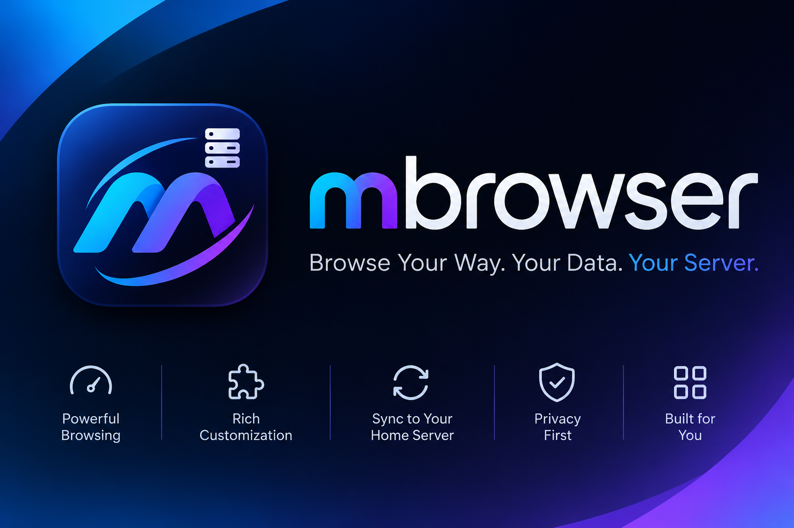
</p>

<h1 align="center">mbrowser</h1>

<p align="center">
  <b>A fast, private browser for Linux, Windows and Android that syncs to a server you own.</b><br>
  Bookmarks, speed dials, history, open tabs, passwords and settings follow you everywhere, with no third-party cloud.
</p>

<p align="center">
  <a href="https://github.com/flesheatingbug/mbrowser/actions/workflows/build.yml"></a>
  <a href="https://github.com/flesheatingbug/mbrowser/actions/workflows/android.yml"></a>
  <a href="https://github.com/flesheatingbug/mbrowser/releases"></a>
</p>

---

## Why mbrowser

- **Your data stays yours.** Sync goes to a small Docker server you host. Nothing is sent to anyone else, and there is no telemetry.
- **One browser, three platforms.** A desktop browser (Electron) for Linux and Windows, and a native Android app, all kept in step.
- **A start page you can arrange.** Visual speed dials with folders, several pages, wallpapers and drag-and-drop, the same on every device.
- **Built-in privacy.** Ad and tracker blocking, an encrypted password vault and private windows are part of the browser, not add-ons.

---

## Downloads

| Platform | Download |
|----------|----------|
| 🐧 **Linux** (AppImage) | [mbrowser-linux.AppImage](https://github.com/flesheatingbug/mbrowser/releases/download/latest-desktop/mbrowser-linux.AppImage) |
| 🪟 **Windows** (Installer) | [mbrowser-windows-setup.exe](https://github.com/flesheatingbug/mbrowser/releases/download/latest-desktop/mbrowser-windows-setup.exe) |
| 🤖 **Android** (APK) | [mbrowser.apk](https://github.com/flesheatingbug/mbrowser/releases/download/latest-apk/mbrowser.apk) |
| 🐳 **Sync server** (Docker) | [Setup guide](#sync-server--docker-setup-dockge--portainer--compose) |

> **Pre-release builds:** the `next` branch publishes newer builds to the `pre-desktop` and `pre-apk` releases.
> **Android:** enable *Install from unknown sources* in your device settings, then open the APK to install.

---

## Features

### Start page and speed dials
- Several **speed dial pages** shown as tabs, with **folders and sub-folders**, kept in the same order on every device
- **Rearrange** by touch-and-hold and drag: tiles move out of the way, hold over a tile to make a folder, drop onto a page tab to move it. On Android the tiles wobble while you rearrange, like a phone home screen
- **Folder pop-up** with search on desktop and a pop-up on Android
- Cards or icon-only look, choose the number of columns, show or hide titles and the add button, background colour or one of **23 wallpapers**
- A compact **add bar** to type an address and add it in one step; deleted tiles go to a recycle bin
- **Add page to…** on Android: add the open page to any speed dial, to a bookmark folder, or to the **home screen**, and keep it in more than one place if you want

### Bookmarks, history and notes
- **Bookmark manager** (`Ctrl+Shift+O`): folder tree, search, sort, drag and drop, multi-select, edit, move and delete, plus a **recycle bin** that keeps items for 30 days
- Import from other browsers and password managers
- Full **history** view with search and a recycle bin
- **Notes** that sync across devices
- A **side panel** for bookmarks, history, downloads, notes and your own web panels

### Passwords
- **Encrypted vault** (AES-256-GCM): protect it with a master password that works on every device, or with a device key that keeps it on one computer
- **Logins, cards and addresses** with autofill; logins have names and folders
- A key icon in the address bar fills saved logins, on desktop and Android
- Imports from Bitwarden, Chrome and Vivaldi, LastPass, 1Password and KeePass

### Privacy and security
- **Ad and tracker blocker** using EasyList, EasyPrivacy and uBlock filter lists, with element hiding and a per-site allow list
- **Private windows and tabs** with separate storage, Do Not Track and Global Privacy Control
- Certificate details in the address bar, and a warning page for invalid certificates
- No telemetry

### Browsing
- **Search engine badge** in the address bar: click it to switch the engine for this search
- **Translate** a page or selected text, **find in page**, zoom, and a status bar with tab count and time
- **Desktop site** mode remembered per site, and a browser identity setting for sites that are picky about browsers
- Downloads manager with a right-click menu: open, show in folder, copy address, restart, pause and remove
- **Tabs from other devices**, kept in sync
- Tab bar on top or on the left, a customisable toolbar and customisable keyboard shortcuts
- **Quick commands** (`F2`) to find any action by name

### Look and feel
- **14 themes** (including Midnight, Nord, Dracula, Solarized and a high-contrast one) and custom themes, or follow the system
- Several app icons to choose from, slim themed scrollbars and a rounded, framed page area
- First-run **setup wizard** to connect to a server or start standalone, pick a theme and search engine, and choose how the vault is protected

### Profiles
- Separate **profiles**, each in its own window with its own data, avatar and settings
- Choose a default profile, reopen the last one on launch, or reset a profile or the whole app

### Android
- A native app, not a wrapper: address bar with **voice and QR search**, tabs, a bottom toolbar and a full menu
- **Hides the address bar and toolbar** as you scroll down fast, and brings them back when you scroll up (can be turned off in settings)
- **Long-press** links and images for a menu: open in a new or private tab, copy, share and image options
- Speed dials fill the width when you rotate the phone
- Pull to refresh, find in page, translation, desktop site and passwords all built in

### Sync server
- A small, dependency-free **Python and SQLite** server that runs in Docker, with a **web interface**
- Accounts and API keys, with keys that can be shown and copied
- Syncs **bookmarks, history, open tabs, notes, settings, speed dial layout and the encrypted vault**, with conflict handling so two devices never overwrite each other silently
- Backup and restore of your data

---

## How it works

```
  Linux / Windows (Electron)  ──┐
                                ├──  HTTPS  ──▶  your sync server (Docker, SQLite)
  Android (native Kotlin)     ──┘
```

Everything is encrypted in transit, and the password vault is encrypted on your device before it is sent, so the server only ever stores ciphertext for it.

---

## Screenshots

### Desktop — first run

The setup wizard opens the first time you start mbrowser. Connect to your sync server or start standalone, pick a theme and search engine, and choose how the password vault is protected.

| Welcome | Sync server |
|---|---|
| 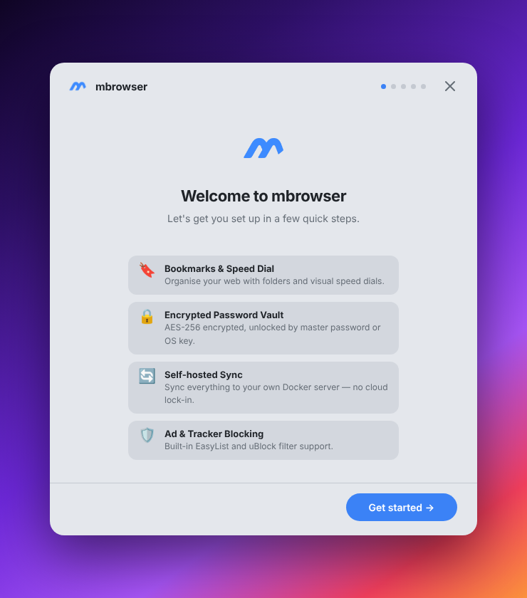 | 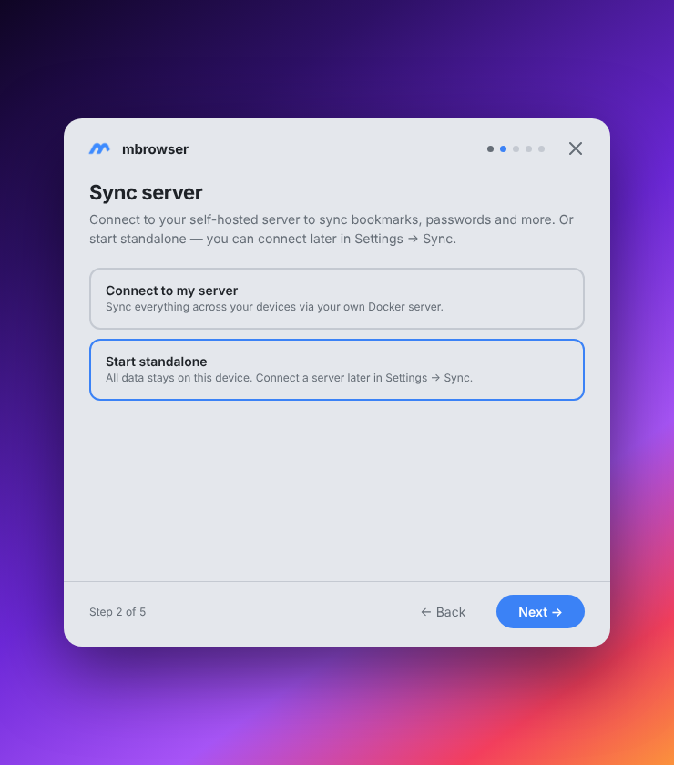 |

| Theme and search engine | Profile and password vault |
|---|---|
| 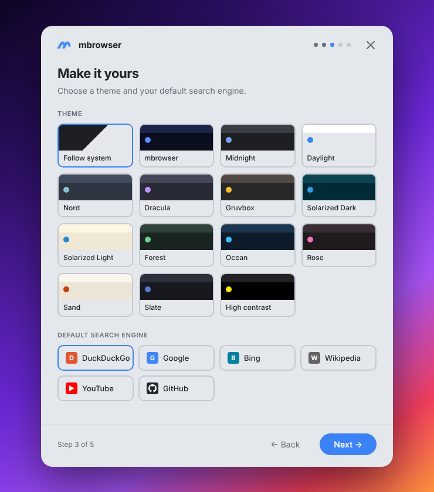 | 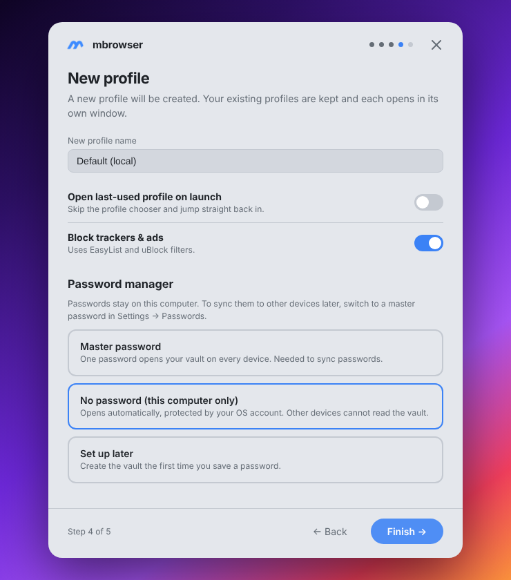 |

### Desktop — default start page

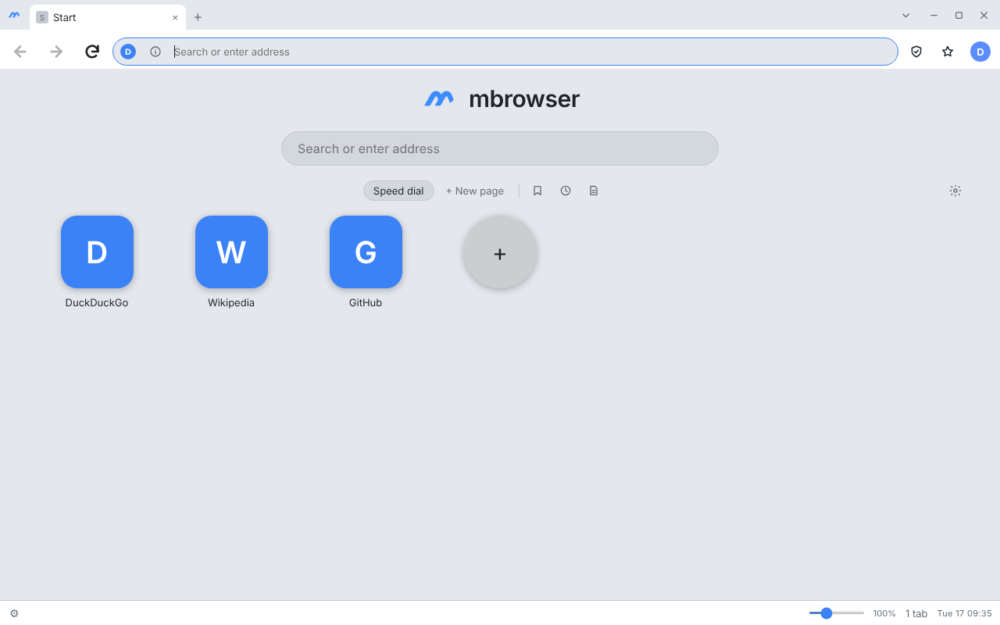

### Android

The native Android app: a speed dial start page with your wallpaper, a full menu, and the same themes and sync as the desktop browser.

<table>
<tr><td align="center">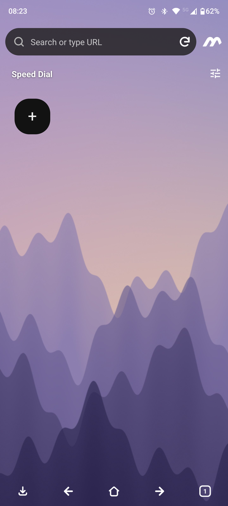<br><sub>Start page</sub></td><td align="center">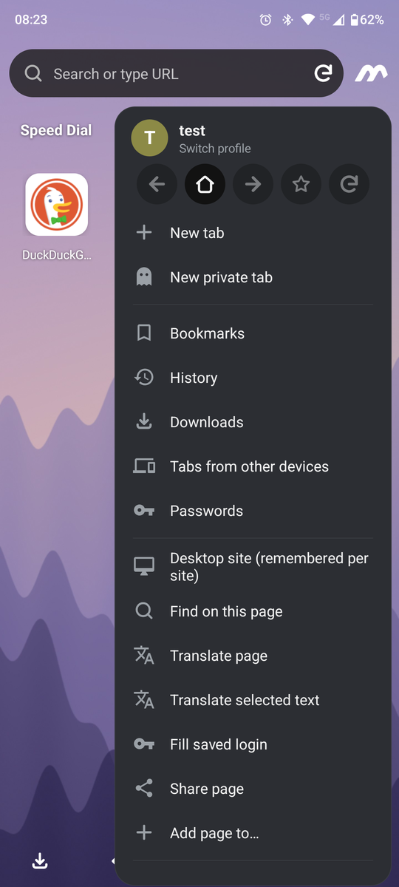<br><sub>Menu</sub></td><td align="center">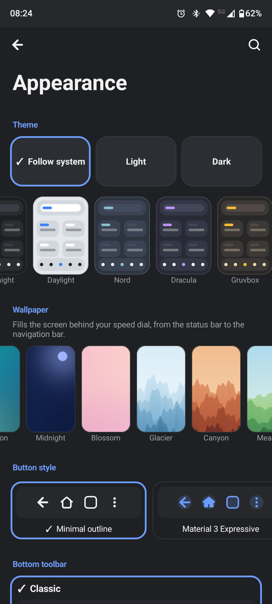<br><sub>Appearance</sub></td><td align="center">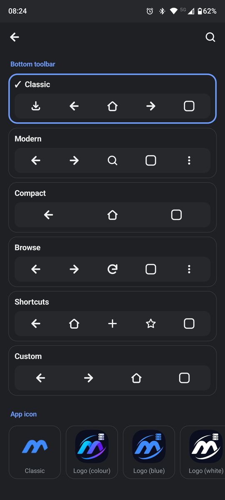<br><sub>Bottom toolbar</sub></td></tr>
<tr><td align="center">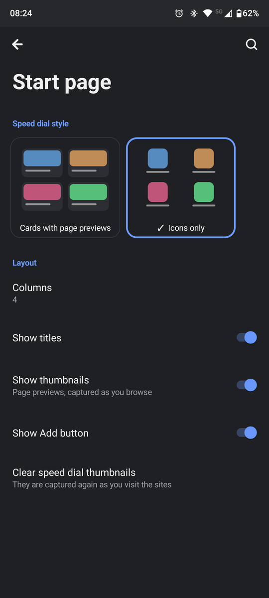<br><sub>Start page settings</sub></td><td align="center">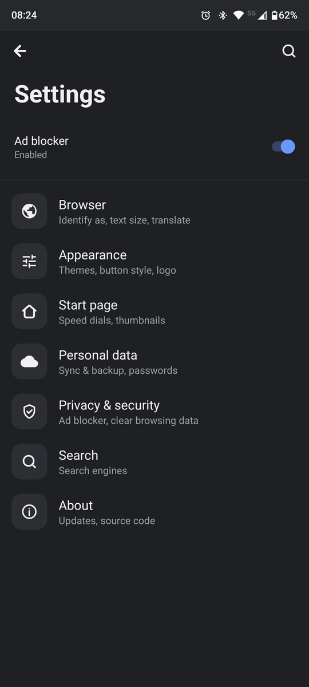<br><sub>Settings</sub></td><td align="center">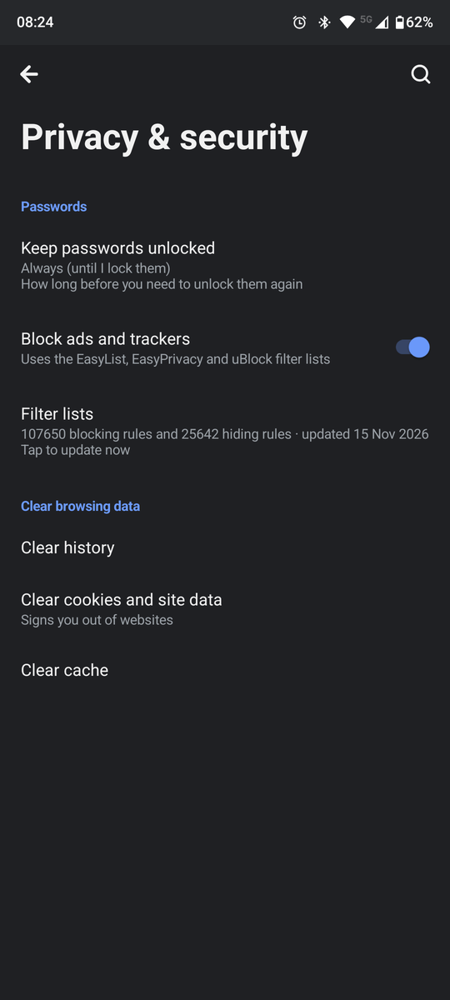<br><sub>Privacy and security</sub></td><td align="center">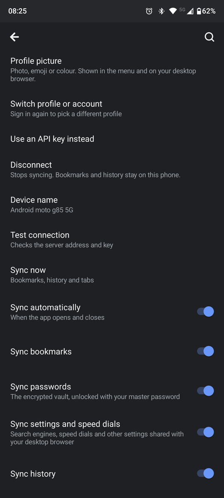<br><sub>Sync</sub></td></tr>
<tr><td align="center">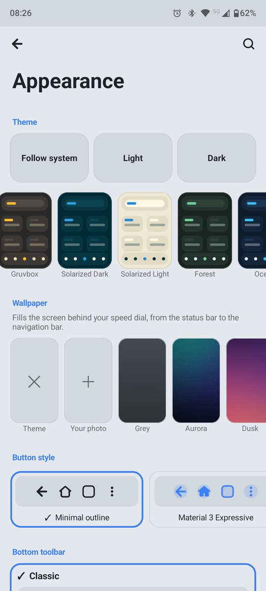<br><sub>Light theme: Appearance</sub></td><td align="center">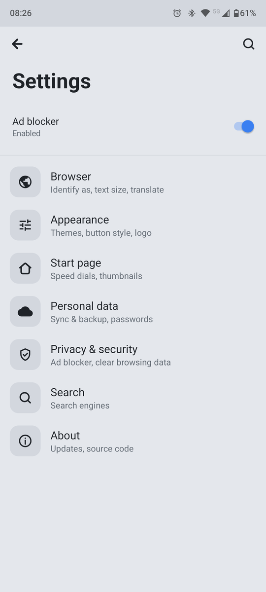<br><sub>Light theme: Settings</sub></td></tr>
</table>

---

## Installing on Linux

### AppImage (recommended)

```bash
chmod +x mbrowser-linux.AppImage
./mbrowser-linux.AppImage
```

Or install it as a system app (adds an application menu entry and desktop icon):

```bash
# Using the system Electron (Arch/CachyOS):
sudo pacman -S electron
git clone https://github.com/flesheatingbug/mbrowser.git
cd mbrowser
electron .
```

### From source

Requires Node 20+ and npm.

```bash
git clone https://github.com/flesheatingbug/mbrowser.git
cd mbrowser
npm install
npm start
```

---

## Installing on Windows

Run **mbrowser-windows-setup.exe** and follow the installer. No administrator rights required (installs per-user by default).

If you see a Windows Defender SmartScreen warning, click **More info → Run anyway** — the app is unsigned.

---

## Keyboard shortcuts

| Action | Shortcut |
|--------|----------|
| Settings | `Ctrl+,` |
| Quick commands | `F2` |
| Side panel | `F4` |
| History | `Ctrl+H` |
| Bookmarks | `Ctrl+Shift+O` |
| Password manager | — (use Quick Commands) |
| New tab | `Ctrl+T` |
| New private window | `Ctrl+Shift+P` |
| Find in page | `Ctrl+F` |

---

## Sync server — Docker setup (Dockge / Portainer / Compose)

mbrowser can run completely standalone (no server needed), or you can self-host the sync server to sync across devices.

### Quick start with Dockge

1. In Dockge, click **+ Compose** and paste the contents of [`server/dockge-stack.yaml`](server/dockge-stack.yaml).
2. Edit the volume path to wherever you want to store data, e.g.:
   ```yaml
   - /opt/mbrowser-sync/data:/config
   ```
3. Set `PUID`/`PGID` to match your server user (run `id` to check).
4. Click **Deploy**.

### Quick start with Docker Compose

```bash
# 1. Clone the repo (or just download the server/ folder)
git clone https://github.com/flesheatingbug/mbrowser.git
cd mbrowser/server

# 2. Copy and edit the env file
cp .env.example .env
nano .env   # set CONFIG_PATH, PUID, PGID, TZ

# 3. Build and start
docker compose up -d --build

# 4. Watch the log
docker compose logs -f
```

The web interface and API will be available at **http://your-server:4242**.

### Environment variables

| Variable | Default | Description |
|----------|---------|-------------|
| `CONFIG_PATH` | `./config` | Host path where the database is stored |
| `HTTP_PORT` | `4242` | Port exposed on the host |
| `PUID` / `PGID` | `1000` | File ownership (run `id` on the host) |
| `TZ` | `Etc/UTC` | Timezone (e.g. `Europe/London`) |
| `ADMIN_USER` | *(blank)* | Auto-create first admin on first run |
| `ADMIN_PASSWORD` | *(blank)* | Auto-create first admin on first run |
| `TRUST_PROXY` | `true` | Trust `X-Forwarded-For` from a reverse proxy |
| `SESSION_DAYS` | `7` | Web login session lifetime |

### Behind Nginx Proxy Manager

1. In the Dockge stack / compose file, **remove** the `ports:` block and uncomment the `networks:` section — set it to your NPM Docker network name.
2. In NPM, create a **Proxy Host** pointing to `mbrowser-sync:4242`.
3. Enable **Websockets support** and add an SSL certificate.

> **Note**: Do not add an Access List to the proxy host — it returns its own 401 which breaks the browser's sync login.

### Connecting the browser

1. Open **Settings → Sync**.
2. Enter your server address (e.g. `https://sync.example.com` or `http://192.168.1.50:4242`).
3. Click **Sign in** and enter your server account credentials.
4. The browser will start syncing automatically.

The server admin panel is available from **Settings → Server Admin** directly inside the browser.

### Maintenance commands

```bash
# List all users
docker exec mbrowser-sync python -m app.cli list-users

# Reset a user's password
docker exec mbrowser-sync python -m app.cli reset-password <username>

# View sync stats
docker exec mbrowser-sync python -m app.cli stats
```

---

## Image update (Docker)

The server image is rebuilt automatically whenever `server/` changes on the `main` branch and published to the GitHub Container Registry:

```
ghcr.io/flesheatingbug/mbrowser-sync:latest
```

To update a running container: in Dockge click **Pull & Restart**, or:

```bash
docker compose pull && docker compose up -d
```

---

## Building from source

The Windows and Linux builds are produced automatically by GitHub Actions. To build locally:

```bash
npm install
npm run dist:linux   # Linux AppImage
npm run dist:win     # Windows installer + zip
```

Output is in `dist/`.

---

## Project structure

```
mbrowser/
├── main.js              # Main process: windows, tabs, IPC, sync, vault
├── preload.js           # Chrome UI ↔ main process bridge
├── page-preload.js      # my:// internal pages bridge
├── ui.html              # Toolbar, tabs, status bar
├── overlay.html         # Popups (password fill, find, etc.)
├── pages/               # Internal browser pages (my:// protocol)
│   ├── start.html       # Speed dial / new tab page
│   ├── bookmarks.html   # Bookmark manager
│   ├── passwords.html   # Password / card / address vault
│   ├── history.html     # Browsing history
│   ├── downloads.html   # Downloads
│   ├── settings.html    # Settings
│   ├── profiles.html    # Profile manager
│   └── ...
├── lib/                 # Shared modules (vault, settings, sync, blocker)
├── server/              # Self-hosted sync server (Python, SQLite, Docker)
└── android/             # Android companion app (Kotlin)
```

---

## License

MIT
